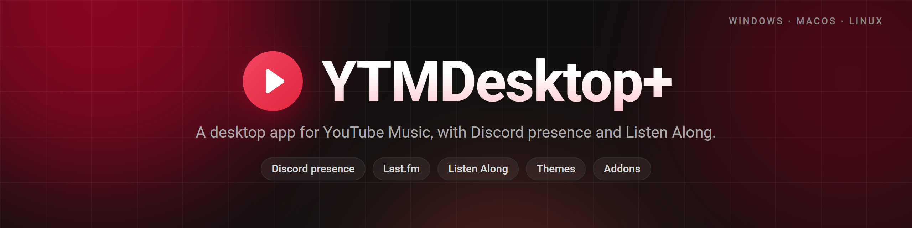

<p align="center">
  
</p>

<p align="center">
  <a href="https://github.com/RealWhyKnot/YTMDesktopPlus/actions/workflows/ci.yml"></a>
  <a href="https://github.com/RealWhyKnot/YTMDesktopPlus/releases/latest"></a>
  <a href="https://ytmdesktopplus.com"></a>
  
  <a href="LICENSE"></a>
</p>

<p align="center">
  <a href="https://github.com/RealWhyKnot/YTMDesktopPlus/releases/latest">Download</a> ·
  <a href="https://ytmdesktopplus.com">Website</a> ·
  <a href="https://github.com/RealWhyKnot/YTMDesktopPlus/issues/new?template=bug_report.yml">Report a bug</a> ·
  <a href="CHANGELOG.md">Changelog</a> ·
  <a href=".github/SECURITY.md">Security</a>
</p>

YTMDesktop+ puts YouTube Music in its own window. It runs the normal player from music.youtube.com and you sign in with your usual account. The app adds media keys, Discord presence, Last.fm scrobbling, themes and addons, plus Listen Along rooms where friends hear what you're playing at the same point in the song.


## What it adds

- Media keys and global shortcuts
- Discord presence with the song and artwork, and a Listen Along button that drops friends straight into your room
- Last.fm scrobbling
- Song change notifications
- Volume above 100%, with a peak limiter and a warning colour on the boosted range
- Ad blocking, off until you turn it on
- What your phone is playing on the same account, shown in the player bar and on Discord while the desktop is idle
- [Themes](docs/themes.md) that restyle the app and the music page together. Sixteen are bundled and switching doesn't need a restart
- [Addons](docs/addons.md) for CSS, page scripts and code, managed in settings. Custom CSS and Listen Along rooms are addons too
- A REST and WebSocket companion server on port 9863 for remote controls, with one-time authorization

Settings and sign-in from an older YouTube Music Desktop App install carry over on first launch.

## Listen Along rooms

Start a room from the tray menu. Friends can join through the link, the Listen Along button on your Discord presence, or an 8 letter code. Listeners follow your playback. You can promote them to let them change tracks, skip, seek and pause for the room.

The link also opens a web player with live audio, track title and artwork, which follows you from one track to the next. Web listeners are anonymous. You see how many are there, not who they are. Your volume setting doesn't affect their audio, but muting the app mutes the stream.

Discord presence starts a room automatically and notifies you. You can turn automatic rooms off in settings.

You choose a display name before hosting or joining. It isn't taken from your account. The room service doesn't keep names, members or rooms after they close. With Listen Along turned off, the app doesn't connect to the room service.

## Install

Get the build for your system from the [latest release](https://github.com/RealWhyKnot/YTMDesktopPlus/releases/latest). Nightly betas go on the [releases page](https://github.com/RealWhyKnot/YTMDesktopPlus/releases) whenever there are new changes. Debug logging is on by default in betas and off in stable builds.

### Windows

Run `YTMDesktopPlus-<version>.Setup.exe`. The app can update itself on launch. It asks the first time, and you can change that later in settings. Updates follow the channel you installed unless you pick another one.

### macOS

Download the zip for your Mac, `darwin-arm64` for Apple silicon or `darwin-x64` for Intel, unzip it and move the app to Applications. The builds aren't notarized, so macOS will refuse to open the app the first time. Allow it under System Settings > Privacy & Security. If macOS says the app is damaged, run:

```bash
xattr -dr com.apple.quarantine /Applications/YTMDesktopPlus.app
```

### Linux and Steam Deck

For Debian or Ubuntu, use the `.deb`. For Fedora, use the `.rpm`.

On Steam Deck, install the `.flatpak` through Discover or run:

```bash
flatpak install --user ./YTMDesktopPlus-x86_64.flatpak
```

Flatpak needs the Flathub remote, which SteamOS includes.

The `.AppImage` runs without installing on x86_64 and aarch64. Make it executable before running it. On Ubuntu 24.04 and Debian 13 you'll also need the [AppArmor profile](packaging/apparmor/ytmdesktop-plus):

```bash
sudo cp packaging/apparmor/ytmdesktop-plus /etc/apparmor.d/ytmdesktop-plus
sudo apparmor_parser -r /etc/apparmor.d/ytmdesktop-plus
```

## Building from source

```bash
git clone https://github.com/RealWhyKnot/YTMDesktopPlus.git
cd YTMDesktopPlus
corepack enable
yarn install
yarn start
```

You'll need Node.js 22.12 or newer and Git. [CONTRIBUTING.md](CONTRIBUTING.md) covers the checks a pull request has to pass and how to build the installers.

## License

GPL-3.0. See [LICENSE](LICENSE). Based on [ytmdesktop](https://github.com/ytmdesktop/ytmdesktop) (GPL-3.0), modified since August 2026. The original history is in that repository.

YTMDesktop+ is not affiliated with Google or YouTube.
